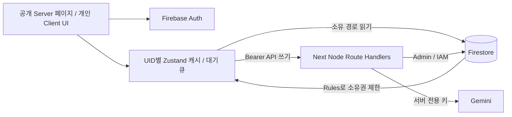

> 자료 기반 생성 최신 변경: [MATERIAL_CREATION.md](MATERIAL_CREATION.md). 현재 기본 모드는 자료로 만들기이며, 카드의 선택적 해설/태그/분류 필드를 저장합니다.

> 최신 구현: [Phase 3 구현 기록](PHASE3_IMPLEMENTATION.md). 아래 최초 분석·설계·단계별 기록은 작성 시점의 내용입니다. 현재는 로컬→Firestore 이전, 생성 결과 검토 후 저장, 카드 관리, 4단계 복습과 통계가 추가되었습니다.

# Phase 2 — 아키텍처 설계 (미구현)

> Phase 1·2 기준선/승인 설계 문서입니다. Phase 3 작업 1의 현재 코드·구체화된 결정은 [FIRESTORE_SYNC.md](FIRESTORE_SYNC.md)를 참고하세요.

## 현재 → 권장

현재: Client StudyApp → UID Zustand/localStorage; 생성만 Next Route Handler → Admin 인증 → Gemini.
권장: 기존 React/CSS/Zustand를 유지하고 서버 소유 쓰기와 UID 범위 읽기를 분리한다.

## 책임과 모듈

- `features/decks`, `generation`, `review`, `stats`, `settings`로 StudyApp 책임을 점진 분리. 기존 컴포넌트·색상·패널 유지.
- `lib/domain`: 스키마, ID, 순수 scheduler, 날짜/통계 함수. `lib/repositories`: local/firestore adapter. `lib/server`: 인증, 권한, 사용량, 거래, Gemini.
- 서버 API가 덱·카드·복습·집계·이관·삭제의 유일한 쓰기 주체. Client Firestore Rules는 본인 읽기만 허용. 서버는 Rules를 우회하므로 모든 UID는 토큰에서 추출하고 IAM 최소권한·스키마·revision 검사를 수행한다.
- 기존 공개키 기반 토큰검증과 달리 Firestore Admin 쓰기에는 ADC/workload identity 등 실제 자격증명이 필요. 비밀키를 NEXT_PUBLIC에 두지 않는다. 계정/리전/배포 방식 확인 전 설정하지 않는다.
- 공개 `/`, `/about`, `/features`, `/login`, `/privacy`, `/terms`; 개인 `/app`, `/app/decks`, `/app/decks/new`, `/app/decks/[deckId]`, `/app/review`, `/app/stats`, `/app/settings`. 개인 UI AuthGate, API는 독립 토큰검증. 로그인 returnTo는 앱 내부 allowlist만. Firebase 브라우저 인증을 서버 쿠키로 가정하지 않는다.
- 공개 metadata/canonical/OG/robots/sitemap은 실도메인 확정 후. 개인 페이지 noindex, 개인 응답 공유 캐시 금지.

## 동기화와 충돌

인증 확정→이전 UID 구독 해제/메모리 폐기→해당 UID 캐시 검증→이관 상태 확인→서버 snapshot 수신 순서다. 로그아웃으로 데이터 원본은 지우지 않고 화면·메모리·실행중 작업만 닫는다. 진행중 응답은 auth epoch/UID가 바뀌면 적용하지 않는다. 공유 기기용 Firestore 디스크 영속 캐시는 초기 비활성화하고 계정별 초안/큐만 관리한다.

초기 덱 요약 페이지당30개, 카드 덱별50개, 복습 due 카드50개씩 커서 조회. 무제한 전체 컬렉션 listener 금지. 현재 화면의 덱 요약/선택 덱만 구독하고 화면 종료 시 해제. 전체 복습은 페이지를 이어 읽어 모든 카드를 한 번씩 처리한다. 일별 집계로 통계 화면에서 이벤트 전체 재조회 방지.

수정은 expectedRevision으로 낙관적 동시성 검사. 충돌409에서 서버본과 초안을 함께 보여 재적용. 복습은 카드 revision과 eventId를 확인하는 서버 transaction. 두 기기의 서로 다른 평가가 같은 revision을 기반으로 하면 한 건만 반영하고 다른 건은 충돌로 사용자에게 안내한다. UI 연속 클릭 잠금도 추가한다.

오프라인 편집/평가는 UID별 outbox에 mutationId와 원 revision을 저장. 온라인에서 순서대로 전송하고 서버 확인 후 큐 제거. 평가 당시 시각은 참고용이고 서버가 수용 범위 검증; due 계산은 서버 처리 시각 기준. AI 생성은 온라인만. outbox 재생·새로고침·계정전환으로 중복을 만들지 않는다.

## 생성 비용 보호

검증/인증→idempotency 확인→Firestore 원자 예약→Gemini 호출(트랜잭션 밖)→결과 검증·초안 저장→사용량 확정 순서. 동일 UID 동시 실행1개, 하루3회. 요청 ID와 정규화 입력 hash를 묶고 다른 payload 재사용409. request result로 네트워크 재시도에 기존 초안을 반환한다.

일일 문서에 charged+reserved < limit을 검사하고 UID 전역 lock을 같은 transaction에서 획득한다. UTC 자정 전후에도 lock은 UID 전역으로 유지한다. lease 만료 시 무조건 환불/재호출하지 않는다. 호출 전 실패는 환불, provider 호출 이후 실패/타임아웃/응답 불명은 보수적으로 1회 차감하고 상태 unknown/failed로 기록하여 비용 남용 차단. 결제 실패 의미와 구분하여 UI에 정책 안내. 서버 장애 후 reconciliation에서 reservation을 확정하고 동일 request는 재호출 금지.

재시도는 기존 일시5xx 최대2회를 상한으로 유지하되 실제 provider attempt별 전역 예산을 원자 예약한다. 일일 사용자3회는 provider 최대9회가 될 수 있으므로 비용 계산에 반영한다. 비용 차단 설정, 전역 일일 토큰/요청 예산, 짧은 실패 cooldown이 필요. 개인 quota만으로 다계정 공격을 막지 못한다. App Check·인프라 rate limit은 실제 호스팅 결정 후 보강한다.

## 비용·개인정보 검토

Gemini 비용은 모델별 입력/출력(생각 토큰 포함 여부 확인) 단가×실제 토큰, 재시도, 운영 일수로 산정한다. 현재 기본 모델 문자열은 `gemini-3.5-flash`; 실제 키 접근성과 적용 단가를 검증하지 않았으므로 무료/정상 사용 가능으로 단정하지 않는다. 출력 상한 초기 제안8192 토큰(20장 테스트로 조정), 본문64KiB·자료15,000자 유지. 모델 교체는 품질/단가 비교 후 별도 결정한다.

무료 서비스와 유료 서비스는 입력·출력의 제품 개선 사용 조건이 다르다. 민감 자료 입력 금지 안내와 적용 요금제/지역별 약관 확인이 출시 선행 조건이다. 서버 로그는 requestId/UID/날짜/모델/상태/usageMetadata만, 내용은 초안 저장 외 로그 금지. 초안7일·운영 메타데이터30일 보존 제안(정책 승인 필요).

Firestore는 문서 읽기/쓰기·인덱스·저장·트래픽 비용이 발생하며 Rules 내부 조회도 비용에 영향을 줄 수 있다. 예산 경보를 비용 상한으로 간주하지 않는다. 예상 비용은 DAU, 생성빈도, 평균토큰, 덱/카드 수, 지역 단가가 확인되어야 산출 가능하다.

## 공식 자료 (2026-10-21 확인)

- [Gemini 가격](https://ai.google.dev/gemini-api/docs/pricing), [데이터 처리 약관](https://ai.google.dev/gemini-api/terms)
- [Firestore 가격](https://firebase.google.com/docs/firestore/pricing), [제한](https://firebase.google.com/docs/firestore/quotas)
- [서버 SDK와 IAM](https://firebase.google.com/docs/firestore/client/libraries), [트랜잭션](https://firebase.google.com/docs/firestore/manage-data/transactions)
- 로컬 Next 가이드 `node_modules/next/dist/docs/01-app/03-api-reference/01-directives/use-client.md`, `03-file-conventions/route.md` 확인. 동적 params는 Promise로 처리한다.
